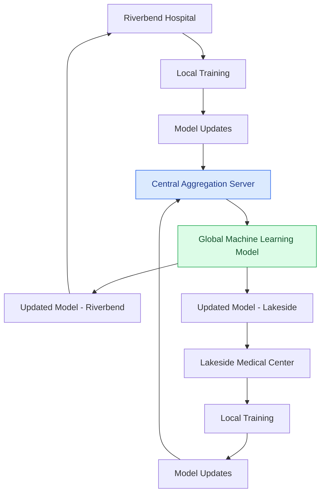

# Federated Learning: Addressing Data Challenges in Distributed Machine Learning

## 1. Project Overview

This case study explores the challenges of implementing federated learning across two healthcare institutions: Riverbend Hospital and Lakeside Medical Center.

Federated learning enables multiple organizations to collaboratively train machine learning models without directly sharing their raw datasets.

The objective is to investigate why a shared model may perform differently across institutions and identify potential solutions.

## 2. Problem Statement

A federated learning model performs well at Riverbend Hospital but underperforms at Lakeside Medical Center.

Potential causes include differences in patient demographics, inconsistent diagnostic labeling, and limitations in the model aggregation process.

## 3. Key Machine Learning Challenges

### Challenge 1: Data Heterogeneity

The hospitals serve different patient populations. Differences in age, medical histories, and comorbidities can create distribution shifts.

**Proposed solutions:**
- Compare demographic and clinical data distributions.
- Identify underrepresented patient groups.
- Evaluate model performance separately across institutions.
- Investigate methods for handling non-identically distributed data.

### Challenge 2: Inconsistent Diagnostic Labels

The hospitals may follow different diagnostic criteria and documentation practices.

These inconsistencies can introduce label noise and affect model training.

**Proposed solutions:**
- Establish standardized labeling guidelines.
- Review diagnostic definitions with clinical experts.
- Conduct label-quality audits.
- Investigate ambiguous or conflicting records.

### Challenge 3: Model Aggregation

Federated learning combines locally trained model updates to create a shared global model.

However, differences between local datasets may cause simple aggregation methods to produce uneven results.

**Proposed solutions:**
- Evaluate Federated Averaging (FedAvg).
- Compare global and locally trained model performance.
- Explore personalized federated learning.
- Monitor performance across institutions after each training round.

## 4. Model Evaluation Framework

The following metrics can help evaluate model performance:

- Accuracy: Overall prediction correctness.
- Precision: Proportion of positive predictions that are correct.
- Recall: Ability to identify actual positive cases.
- F1-score: Balance between precision and recall.
- Group-level performance: Differences in performance across relevant patient populations.

Evaluation should consider both overall performance and institutional differences.

## 5. Privacy and Responsible AI

Federated learning reduces the need to centralize raw patient data, but it does not automatically guarantee privacy.

Important considerations include:

- Secure communication of model updates.
- Differential privacy where appropriate.
- Monitoring potential information leakage.
- Auditing model performance for bias.
- Maintaining human oversight in clinical applications.

## 6. Key Takeaways

This case study demonstrates that successful machine learning implementation requires more than selecting an appropriate algorithm.

Data quality, population differences, labeling consistency, and aggregation strategies can significantly influence model performance.

Federated learning provides opportunities for collaborative machine learning while limiting direct sharing of raw data. However, organizations must carefully evaluate technical performance, privacy risks, and fairness.

## 7. Professional Relevance

These concepts extend beyond healthcare.

In business analytics and consumer research, organizations frequently combine information from different markets, customer segments, and data sources.

Understanding data heterogeneity, model evaluation, and responsible AI practices is valuable when developing predictive models and translating analytical outputs into business recommendations.

This project strengthened my understanding of practical machine learning challenges and the importance of critically evaluating AI systems before real-world deployment.

## 8. Federated Learning Architecture

The following diagram illustrates how two healthcare institutions can collaboratively train a shared machine learning model without directly exchanging raw patient data.

**Key Insight:** Each hospital retains its local patient data while sharing model updates with the aggregation server. The global model is then distributed back to participating institutions for further training.

---

**Artifact Type:** Applied Machine Learning Case Study

**Core Competencies:** Federated Learning, Data Quality, Distribution Shift, Model Evaluation, Responsible AI

**Project Format:** Conceptual case study based on an academic scenario.

